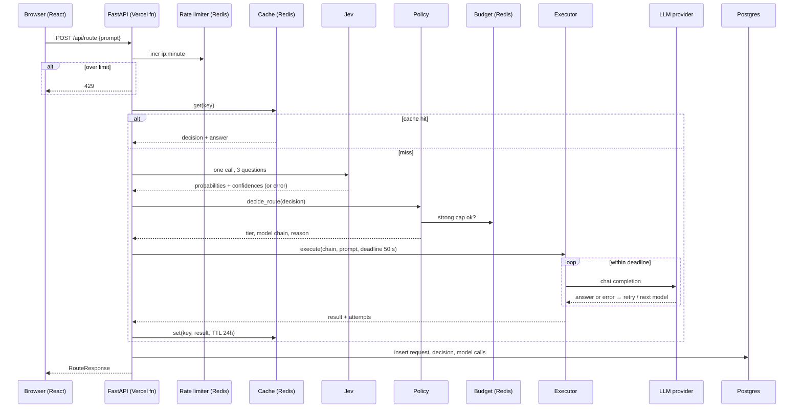
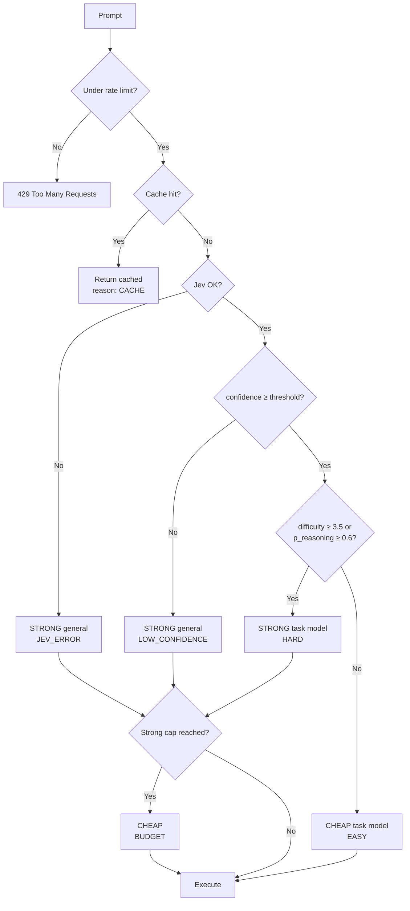
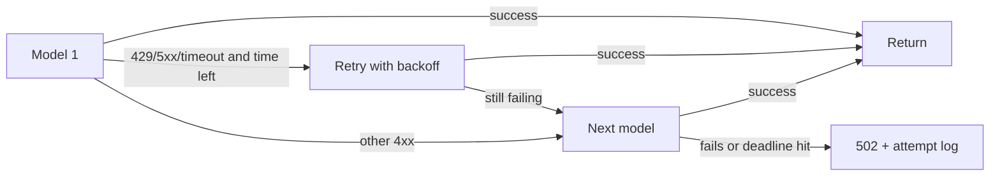
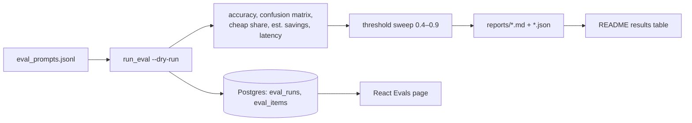
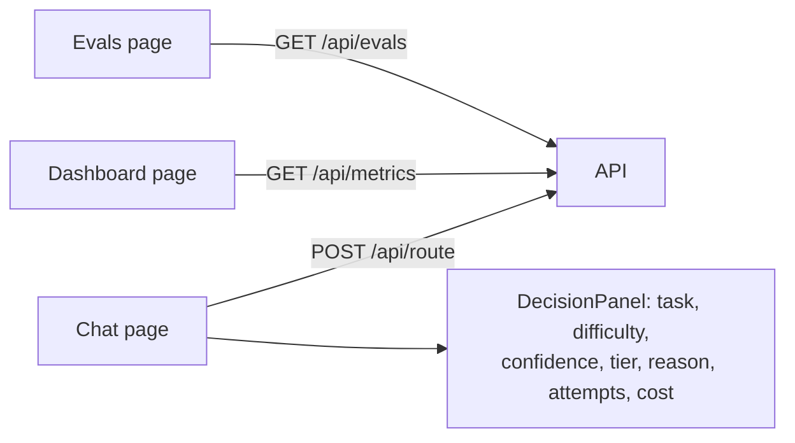

# Project Flow: Switchyard

## 1. Request flow (`POST /api/route`)

## 2. Routing decision

## 3. Execution within the time budget

## 4. Evaluation (runs on laptop)

Then run `--with-answers --limit 20` for the manual quality check.

## 5. Frontend flow

## 6. Dev workflow per feature
Red test → Claude Code makes it green → refactor → commit referencing FR id
(e.g. `feat(policy): FR-3 low-confidence fallback`) → push → CI → Vercel preview deploy.
