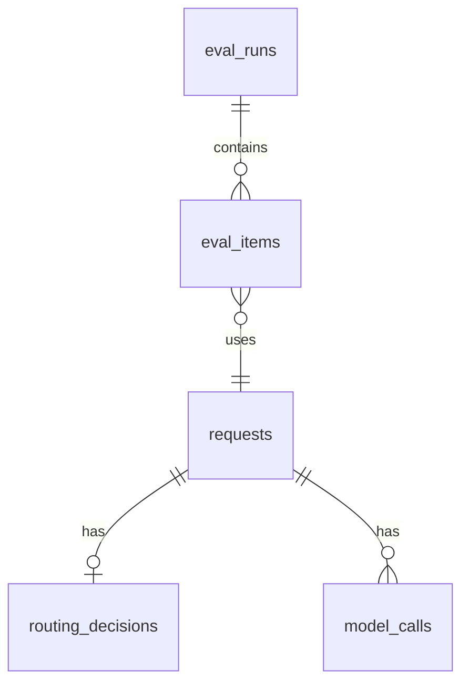

# Schema: Postgres, Redis, API

## Part A: Postgres



### `requests`
| Column | Type | Notes |
|---|---|---|
| id | UUID PK | |
| created_at | TIMESTAMPTZ | default now(); indexed |
| prompt_text | TEXT | |
| prompt_hash | CHAR(64) | sha256 of normalized prompt; indexed |
| source | TEXT | CHECK in (`ui`,`api`,`eval`) |
| client_ip_hash | CHAR(64) NULL | hashed, never raw IP |
| dry_run | BOOLEAN | |
| cache_hit | BOOLEAN | |
| status | TEXT | `success` / `failed` |
| final_model | TEXT NULL | |
| response_text | TEXT NULL | |
| total_latency_ms | INTEGER | |
| est_cost_usd | NUMERIC(12,8) | Jev + model, at list prices |
| baseline_cost_usd | NUMERIC(12,8) | same tokens at baseline model prices |
| config_version | TEXT | |

### `routing_decisions`
| Column | Type | Notes |
|---|---|---|
| id | UUID PK | |
| request_id | UUID FK UNIQUE → requests ON DELETE CASCADE | |
| task_type | TEXT | `code`/`math`/`writing`/`general` |
| task_type_probs | JSONB | |
| difficulty | REAL | 1–5 expected value |
| difficulty_dist | JSONB | |
| needs_reasoning_prob | REAL | |
| confidence | REAL | |
| tier | TEXT | `cheap`/`strong` |
| reason | TEXT | `EASY`/`HARD`/`LOW_CONFIDENCE`/`JEV_ERROR`/`BUDGET`/`CACHE` |
| model_chain | JSONB | ordered list |
| jev_model | TEXT NULL | version Jev reported |
| jev_latency_ms | INTEGER NULL | |
| jev_input_tokens | INTEGER NULL | |
| jev_error | TEXT NULL | |

### `model_calls`
| Column | Type | Notes |
|---|---|---|
| id | UUID PK | |
| request_id | UUID FK → requests; indexed | |
| model | TEXT | config key |
| attempt_no | INTEGER | |
| status | TEXT | `success`/`rate_limited`/`server_error`/`timeout`/`client_error`/`deadline` |
| error_message | TEXT NULL | |
| latency_ms | INTEGER | |
| input_tokens / output_tokens | INTEGER NULL | |
| est_cost_usd | NUMERIC(12,8) | |

### `eval_runs`
| Column | Type | Notes |
|---|---|---|
| id | UUID PK | |
| created_at | TIMESTAMPTZ | |
| dataset_hash | CHAR(64) | |
| config_version | TEXT | |
| threshold | REAL | |
| dry_run | BOOLEAN | |
| summary | JSONB | metrics + sweep |

### `eval_items`
| Column | Type | Notes |
|---|---|---|
| id | UUID PK | |
| eval_run_id | UUID FK; indexed | |
| prompt_id | TEXT | |
| request_id | UUID FK NULL | |
| expected_task_type / predicted_task_type | TEXT | |
| expected_tier / predicted_tier | TEXT | |
| correct_task / correct_tier | BOOLEAN | |
| quality_rating | TEXT NULL | `good`/`acceptable`/`bad` (manual) |

Dataset `data/eval_prompts.jsonl`:
```json
{"id": "c-001", "prompt": "Reverse a string in Python", "task_type": "code", "tier": "cheap"}
```
100 prompts: 25 per task type, about half cheap and half strong.

## Part B: Redis keys
| Key | Type | TTL | Purpose |
|---|---|---|---|
| `cache:{config_version}:{prompt_sha256}` | string (JSON) | 86,400 s | Cached decision + answer |
| `rl:{ip_hash}:{yyyymmddHHMM}` | integer (INCR) | 120 s | Per-IP rate limit |
| `budget:strong:{yyyy-mm-dd}` | integer (INCR) | 2 days | Daily strong-model cap |

## Part C: API (all under `/api`)

### `POST /api/route`
Request
```json
{ "prompt": "Write a function to check if a number is prime", "use_cache": true, "dry_run": false }
```
Response `200`
```json
{
  "request_id": "6f1c…",
  "cache_hit": false,
  "decision": {
    "task_type": "code",
    "task_type_probs": {"code": 0.93, "math": 0.04, "writing": 0.01, "general": 0.02},
    "difficulty": 1.8,
    "needs_reasoning_prob": 0.12,
    "confidence": 0.88,
    "tier": "cheap",
    "reason": "EASY",
    "model_chain": ["cheap-code", "cheap-general"],
    "jev_latency_ms": 142
  },
  "response": {
    "model": "cheap-code",
    "text": "def is_prime(n): …",
    "latency_ms": 910,
    "attempts": [{"model": "cheap-code", "attempt_no": 1, "status": "success", "latency_ms": 910}]
  },
  "cost": {"est_cost_usd": 0.00004, "baseline_cost_usd": 0.0021, "saved_usd": 0.00206},
  "total_latency_ms": 1075
}
```
Errors: `422` empty or > 8,000-character prompt · `429` rate limited (`Retry-After`
header) · `502` all models failed or deadline hit (body has `attempts`).

### Other endpoints
| Method | Path | Returns |
|---|---|---|
| GET | `/api/health` | `{status, config_version, db: ok, redis: ok}` |
| GET | `/api/requests?limit=50` | Recent requests with decision summary |
| GET | `/api/requests/{id}` | Full request, decision, model calls |
| GET | `/api/metrics?since=` | Dashboard aggregates (below) |
| GET | `/api/evals` | Eval runs with summaries |
| GET | `/api/evals/{id}` | One run with items |

### `GET /api/metrics`
```json
{
  "total_requests": 240,
  "tier_split": {"cheap": 0.58, "strong": 0.42},
  "task_split": {"code": 0.3, "math": 0.2, "writing": 0.25, "general": 0.25},
  "reason_split": {"EASY": 0.55, "HARD": 0.3, "LOW_CONFIDENCE": 0.1, "JEV_ERROR": 0.01, "CACHE": 0.04},
  "est_cost_usd": 0.21, "baseline_cost_usd": 0.52, "savings_pct": 59.6,
  "latency_ms": {"jev_p50": 120, "jev_p95": 410, "total_p50": 1300, "total_p95": 4200},
  "fallback_rate": 0.03, "cache_hit_rate": 0.04
}
```

### Frontend types
Generated, never hand-written:
`npx openapi-typescript http://localhost:8000/api/openapi.json -o web/src/api/types.ts`
